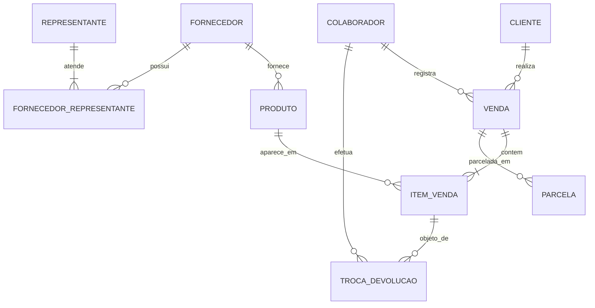

# Modelo Lógico Relacional e Normalização

**Projeto:** ERP da loja Conectados na Moda · **Disciplina:** Modelagem de Dados · **Equipe 7**
**Etapa:** Entrega final (evolução da 1ª entrega)
**SGBD alvo:** MySQL 8.0.16 ou superior (necessário para as restrições `CHECK`)

**Convenções deste documento:** `RN01`–`RN12` são as regras de negócio numeradas do README (seção 8); `RF` e `RNF` são os requisitos; `P1`–`P4` são os problemas da tabela da seção 4 do README (P1 vendas em caderno, P2 troca de nomes de clientes, P3 atraso no crediário, P4 estoque). "Política" refere-se à seção 9 do README.

---

## 1. Revisão da 1ª entrega: o que mudou e por quê

| # | O que foi alterado | Como era | Como ficou | Por que alteramos |
|---|---|---|---|---|
| 1 | Relacionamento REPRESENTANTE–FORNECEDOR | Relacionamento R5 sem tratamento, embora a cardinalidade (1,N)–(0,N) já indicasse N:N | Tabela associativa `FORNECEDOR_REPRESENTANTE` com PK composta | Um representante atende vários fornecedores e um fornecedor pode ter vários representantes. Relacionamento N:N não é implementável direto no modelo relacional (mesmo raciocínio aplicado a VENDA × PRODUTO na Aula 5) |
| 2 | Cardinalidade ITEM_VENDA–TROCA_DEVOLUCAO | Texto da análise dizia "no máximo uma ocorrência" (0,1); a tabela dizia (0,N) | (0,N), com texto corrigido | Um item de quantidade 3 pode ter trocas ou devoluções parciais em datas diferentes (RF07) |
| 3 | Identificação do cliente | Somente `id_cliente` e `nome` | Acréscimo de `cpf` (opcional e único), obrigatório quando o cliente tem limite de crédito | P2 pede "identificar melhor cada cliente". Política: crediário tem limite por cliente e RN11 coloca a cobrança com a Dona, e só se cobra quem está identificado |
| 4 | Atributos derivados | Tracejados no DER (`margem`, `setor_tamanho`, `subtotal`, `valor_total`, `situacao` da parcela) e ausentes do dicionário | Decisão registrada: **não viram coluna**; são calculados em consultas ou views | Guardá-los criaria dependências entre atributos não chave e risco de divergência (ver seção 5.3) |
| 5 | Entidade PARCELA | Na auditoria da Aula 6, o grupo não identificou entidade fraca e imaginou uma "Conta_Receber" apenas como hipótese | PARCELA é entidade fraca de VENDA, com PK composta `(id_venda, numero_parcela)` | O número da parcela (1 a 4, RN07) se repete em toda venda e só identifica a parcela junto com a venda. A auditoria já apontava a Parcela como a candidata |
| 6 | Atributo `tamanho` | Marcado como "provisório" | Confirmado como atributo de PRODUTO, com domínio fechado por `CHECK` | RN02 e RN03 definem os tamanhos válidos |
| 7 | PRODUTO | Dúvida em aberto sobre separar modelo e peça | Mantido como "peça" (descrição + tamanho + cor), com justificativa na seção 5.4 | RF05, RN04 e RN05: o estoque é controlado por tamanho e cor |

> Os itens 1 e 3 alteram o DER (nova entidade associativa e novo atributo). O DER, o README e o dicionário devem ser atualizados para acompanhar esta versão.

---

## 2. Modelo lógico

### 2.1 Esquema relacional

Notação: `TABELA(campo PK, campo FK, ...)`

```
CLIENTE(id_cliente PK, nome, cpf, telefone, data_nascimento,
        limite_credito, situacao_crediario)

COLABORADOR(id_colaborador PK, nome, tipo)

FORNECEDOR(id_fornecedor PK, nome, cnpj)

REPRESENTANTE(id_representante PK, nome, telefone, cnpj)

FORNECEDOR_REPRESENTANTE(id_fornecedor PK/FK, id_representante PK/FK)

PRODUTO(id_produto PK, descricao, categoria, tamanho, cor, colecao,
        preco_custo, preco_venda, quantidade_estoque,
        id_fornecedor FK)

VENDA(id_venda PK, data_hora, canal, forma_pagamento, tipo_entrega,
      percentual_desconto, data_hora_cancelamento,
      id_cliente FK, id_colaborador FK)

ITEM_VENDA(id_venda PK/FK, id_produto PK/FK, quantidade, preco_unitario)

PARCELA(id_venda PK/FK, numero_parcela PK, valor_parcela,
        data_vencimento, data_pagamento)

TROCA_DEVOLUCAO(id_troca PK, tipo, quantidade, data_hora,
                id_venda FK, id_produto FK, id_colaborador FK)
-- (id_venda, id_produto) é uma FK composta que referencia ITEM_VENDA
```

### 2.2 Diagrama das tabelas e relacionamentos



### 2.3 Chaves primárias

| Tabela | PK | Por que identifica um único registro | Por que esta escolha |
|---|---|---|---|
| CLIENTE | `id_cliente` | Código sequencial gerado pelo sistema | O `cpf` é chave candidata, mas é opcional (pode ser nulo) e é dado pessoal; o `nome` se repete (P2). Um identificador técnico não depende de dados do negócio que podem mudar, critério já adotado pelo grupo na Aula 6 |
| COLABORADOR | `id_colaborador` | Código sequencial | Nomes podem coincidir entre freelancers |
| FORNECEDOR | `id_fornecedor` | Código sequencial | Evita usar o nome como chave |
| REPRESENTANTE | `id_representante` | Código sequencial | Idem |
| FORNECEDOR_REPRESENTANTE | `(id_fornecedor, id_representante)` | O par é a própria associação | Impede registrar duas vezes o mesmo vínculo; a tabela não precisa de atributos próprios |
| PRODUTO | `id_produto` | Código sequencial | Cada linha é uma peça específica (descrição, tamanho e cor), e o estoque é por peça (RF05) |
| VENDA | `id_venda` | Código sequencial | Número da venda não depende de dados que mudam; é o que o caderno da loja não tinha (P1) |
| ITEM_VENDA | `(id_venda, id_produto)` | Um produto aparece uma vez por venda | Repetições são consolidadas em `quantidade`; é o que resolve o N:N entre VENDA e PRODUTO (Aula 5) |
| PARCELA | `(id_venda, numero_parcela)` | O número (1 a 4) só identifica a parcela dentro de uma venda | Entidade fraca de VENDA |
| TROCA_DEVOLUCAO | `id_troca` | Código sequencial | Um mesmo item pode ter várias ocorrências (0,N), então o par `(id_venda, id_produto)` não poderia ser a chave |

### 2.4 Chaves estrangeiras e integridade referencial

| FK (tabela) | Referencia | Regra de origem | Obrigatória? |
|---|---|---|---|
| `id_cliente` (VENDA) | CLIENTE | Cardinalidade (1,1): toda venda tem um cliente cadastrado (F1: "identificar ou cadastrar cliente") | Sim |
| `id_colaborador` (VENDA) | COLABORADOR | Cardinalidade (1,1): Dona ou freelancer registra a venda | Sim |
| `id_venda` (ITEM_VENDA) | VENDA | Item só existe dentro de uma venda | Sim (faz parte da PK) |
| `id_produto` (ITEM_VENDA) | PRODUTO | Item representa uma peça cadastrada | Sim (faz parte da PK) |
| `id_venda` (PARCELA) | VENDA | Entidade fraca: depende da venda para existir e ser identificada | Sim (faz parte da PK) |
| `id_fornecedor` (PRODUTO) | FORNECEDOR | Cardinalidade (1,1): cada peça tem um fornecedor (F4) | Sim |
| `id_fornecedor`, `id_representante` (FORNECEDOR_REPRESENTANTE) | FORNECEDOR, REPRESENTANTE | Resolve o N:N | Sim (fazem parte da PK) |
| `(id_venda, id_produto)` (TROCA_DEVOLUCAO) | ITEM_VENDA | F3: "localizar venda e item"; a ocorrência refere-se a um item vendido | Sim |
| `id_colaborador` (TROCA_DEVOLUCAO) | COLABORADOR | Dona e freelancers podem efetuar trocas (Política) | Sim |

**Ação referencial:** todas as FKs usam `ON DELETE RESTRICT`. Justificativa: RN01 exige que toda venda fique registrada e RF08 exige o histórico de compras do cliente; apagar um cliente, produto ou venda com histórico destruiria essa informação.

---

## 3. Restrições e sua origem

Cada restrição abaixo protege uma regra do negócio. Não foram criadas restrições sem regra de origem.

| Tabela.campo | Restrição | Regra de origem | Justificativa |
|---|---|---|---|
| CLIENTE.cpf | `UNIQUE`, aceita nulo | P2 | Duas pessoas não compartilham CPF, então o campo distingue clientes com o mesmo nome. Aceita nulo porque quem compra só à vista pode não informar; o MySQL permite vários nulos em coluna `UNIQUE` |
| CLIENTE | `CHECK (limite_credito = 0 OR cpf IS NOT NULL)` | Política (limite por cliente), RN11 | Só pode ter limite de crédito quem está identificado; a Dona só consegue cobrar quem foi cadastrado com CPF |
| CLIENTE.limite_credito | `NOT NULL`, `DEFAULT 0`, `CHECK (>= 0)` | Política (limite por cliente) | Valor 0 significa "sem crediário"; limite negativo não tem significado |
| CLIENTE.situacao_crediario | `CHECK IN ('Liberado','Restrito')`, `DEFAULT 'Liberado'` | RN08, F2 | A restrição é anotada no cadastro pela Dona (F2); por isso é armazenada e não derivada |
| COLABORADOR.tipo | `NOT NULL`, `CHECK IN ('Dona','Freelancer')` | RN11, Política | Permite saber quem é a Dona (financeiro e cobrança) |
| FORNECEDOR.cnpj | `NOT NULL`, `UNIQUE` | RF09 | Evita cadastrar o mesmo fornecedor duas vezes, o que dividiria os produtos entre cadastros duplicados |
| REPRESENTANTE.cnpj | `NOT NULL`, `UNIQUE` | RF09 | Evita cadastrar o mesmo representante duas vezes, o que dividiria os produtos entre cadastros duplicados |
| PRODUTO.categoria | `NOT NULL`, `CHECK IN ('Roupa','Acessório')` | Caracterização da empresa | A loja vende roupas e alguns acessórios |
| PRODUTO | `CHECK (categoria = 'Acessório' OR (tamanho IS NOT NULL AND cor IS NOT NULL))` | RN02 | Roupa exige tamanho e cor; acessório pode não ter tamanho |
| PRODUTO.tamanho | `CHECK` com o domínio válido (ver abaixo) | RN03 | Impede tamanhos que a loja não trabalha |
| PRODUTO.colecao | `CHECK IN ('Primavera','Verão','Outono','Inverno')`, aceita nulo | RN12 | Quatro coleções no ano; nulo para peças sem coleção sazonal (a confirmar com a loja) |
| PRODUTO.preco_custo | `NOT NULL`, `CHECK (> 0)` | RN06, RF02 | É a base do cálculo do preço de venda |
| PRODUTO.preco_venda | `NOT NULL`, `CHECK (> 0)` | RN06, RF02 | Não há `CHECK` de "custo × 2,2" porque a regra admite variação por produto; o desvio é conferido por consulta de auditoria |
| PRODUTO.quantidade_estoque | `NOT NULL`, `DEFAULT 0`, `CHECK (>= 0)` | RN04, RN05, P4 | Impede estoque negativo, ou seja, vender peça que não existe |
| VENDA.data_hora | `NOT NULL`, `DEFAULT CURRENT_TIMESTAMP` | RN01, RN10 | Toda venda é registrada e a data/hora é a base do prazo de cancelamento |
| VENDA.canal | `NOT NULL`, `CHECK IN ('Loja física','Instagram','WhatsApp Business')` | Caracterização da empresa | Canais de venda informados pela loja |
| VENDA.forma_pagamento | `NOT NULL`, `CHECK IN ('Dinheiro','Cartão','Pix','Crediário')` | Caracterização da empresa | Formas de pagamento informadas pela loja |
| VENDA.tipo_entrega | `NOT NULL`, `CHECK IN ('Retirada','Uber')` | Caracterização da empresa | Entregas informadas pela loja |
| VENDA.percentual_desconto | `NOT NULL`, `DEFAULT 0`, `CHECK (BETWEEN 0 AND 100)` | RN09 | Descontos são negociados no fechamento; percentual fora de 0 a 100 é erro |
| VENDA | `CHECK (data_hora_cancelamento IS NULL OR (data_hora_cancelamento >= data_hora AND data_hora_cancelamento <= data_hora + INTERVAL 24 HOUR))` | RN10 | O banco recusa cancelamento depois de 24 horas |
| ITEM_VENDA.quantidade | `NOT NULL`, `DEFAULT 1`, `CHECK (> 0)` | RF03, RN04 | Item com quantidade zero ou negativa não representa venda |
| ITEM_VENDA.preco_unitario | `NOT NULL`, `CHECK (>= 0)` | Aula 5 | Guarda o preço praticado na venda, que não muda se o preço do produto mudar depois |
| PARCELA.numero_parcela | `CHECK (BETWEEN 1 AND 4)` | RN07 | Com a PK composta, impede mais de 4 parcelas por venda |
| PARCELA.valor_parcela | `NOT NULL`, `CHECK (> 0)` | RF06 | Parcela sem valor não tem sentido |
| PARCELA.data_vencimento | `NOT NULL` | F2, P3 | É o que permite acompanhar vencimentos e atrasos |
| PARCELA.data_pagamento | aceita nulo | F2 | Nulo significa parcela ainda não paga |
| TROCA_DEVOLUCAO.tipo | `NOT NULL`, `CHECK IN ('Troca','Devolução')` | RF07, F3 | Os dois caminhos do fluxo F3 |
| TROCA_DEVOLUCAO.quantidade | `NOT NULL`, `DEFAULT 1`, `CHECK (> 0)` | RF07 | Ocorrência sem peças não faz sentido |

**Domínio de `tamanho` (RN03):** o campo armazena o tamanho real da peça, conforme o setor: baby (`P`, `M`, `G`); infantil (`1`, `2`, `3`, `4`, `5`, `6`, `7`, `8`, `9`, `10`); juvenil (`12`, `14`, `16`, `18`, `20`). O atributo `setor_tamanho` é derivado e calculado em consulta com `CASE`, a partir do valor de `tamanho`.

---

## 4. O que o banco garante e o que a auditoria verifica

Nem toda regra de negócio pode ser protegida por restrição: o `CHECK` do MySQL enxerga apenas a própria linha, e a FK só garante que o registro referenciado existe. As demais regras viram consultas de auditoria, que serão escritas no script SQL.

| Regra | O banco garante? | Como é tratada |
|---|---|---|
| Venda com pelo menos um item, cardinalidade (1,N) | Não (a venda é inserida antes dos itens) | Auditoria: vendas sem itens |
| Parcelas somente em venda no crediário | Não (o `CHECK` não cruza tabelas) | Auditoria: parcelas em venda cuja forma de pagamento não é crediário, e vendas no crediário sem parcelas |
| Soma das parcelas igual ao total da venda com desconto | Não | Auditoria: diferença entre o total dos itens (com `percentual_desconto`) e a soma das parcelas |
| Crediário dentro do limite do cliente (Política) | Não | Auditoria: clientes cujas parcelas em aberto superam `limite_credito` |
| Cliente com crediário restrito (RN08) sem novas vendas no crediário | Não (depende da ordem no tempo) | Auditoria: vendas no crediário de clientes restritos |
| Troca ou devolução não excede a quantidade vendida | Não | Auditoria: soma das ocorrências por item maior que `ITEM_VENDA.quantidade` |
| Preço de venda coerente com a base custo × 2,2 (RN06) | Não (a regra admite variação) | Auditoria: peças com preço muito distante da base |
| Baixa de estoque na venda (RN04) | Parcial: o banco impede estoque negativo | A baixa é feita pelo processo de venda (`UPDATE` na mesma transação ou gatilho), definida na etapa do SQL |
| Cancelamento em até 24 horas (RN10) | Sim | `CHECK` na VENDA |
| Máximo de 4 parcelas (RN07) | Sim | `CHECK` + PK composta em PARCELA |
| Validade do dígito verificador do CPF | Não | Validação na aplicação; o banco só garante unicidade |
| Acesso por perfil (RNF02) e cobrança pela Dona (RN11) | Não faz parte do modelo | Perfis de usuário do SGBD ou da aplicação |

---

## 5. Normalização

### 5.1 Dependências funcionais do modelo

| Tabela | Chave | Dependências funcionais relevantes |
|---|---|---|
| CLIENTE | `id_cliente` | `id_cliente → nome, cpf, telefone, data_nascimento, limite_credito, situacao_crediario`; `cpf → id_cliente` (chave candidata, quando informado) |
| COLABORADOR | `id_colaborador` | `id_colaborador → nome, tipo` |
| FORNECEDOR | `id_fornecedor` | `id_fornecedor → nome` |
| REPRESENTANTE | `id_representante` | `id_representante → nome, telefone` |
| FORNECEDOR_REPRESENTANTE | `(id_fornecedor, id_representante)` | Sem atributos não chave: a tabela só registra a associação |
| PRODUTO | `id_produto` | `id_produto → descricao, categoria, tamanho, cor, colecao, preco_custo, preco_venda, quantidade_estoque, id_fornecedor` |
| VENDA | `id_venda` | `id_venda → data_hora, canal, forma_pagamento, tipo_entrega, percentual_desconto, data_hora_cancelamento, id_cliente, id_colaborador` |
| ITEM_VENDA | `(id_venda, id_produto)` | `(id_venda, id_produto) → quantidade, preco_unitario` |
| PARCELA | `(id_venda, numero_parcela)` | `(id_venda, numero_parcela) → valor_parcela, data_vencimento, data_pagamento` |
| TROCA_DEVOLUCAO | `id_troca` | `id_troca → tipo, quantidade, data_hora, id_venda, id_produto, id_colaborador` |

### 5.2 Primeira Forma Normal (1FN): um campo, um valor

**Caso 1: os produtos de uma venda (decisão da Aula 5)**
- **Estrutura analisada:** `VENDA(id_venda, data_hora, id_cliente, produtos)`, que é a forma como o caderno da loja anota: vários produtos na mesma anotação (P1).
- **Dependências:** `id_venda → data_hora, id_cliente`; e a venda determina um *conjunto* de produtos com quantidades, ou seja, um atributo multivalorado.
- **Problema:** lista dentro de um campo. Não permite baixar o estoque por produto (RN04) nem somar vendas por produto.
- **Correção:** `ITEM_VENDA(id_venda, id_produto, quantidade, preco_unitario)`, uma linha por produto vendido.

**Caso 2: os representantes de um fornecedor**
- **Estrutura analisada:** converter o relacionamento R5 diretamente levaria a `FORNECEDOR(id_fornecedor, nome, representantes)` ou a colunas `representante1`, `representante2`.
- **Dependências:** um fornecedor determina um conjunto de representantes, e um representante determina um conjunto de fornecedores.
- **Problema:** grupo repetitivo, com limite artificial de representantes por fornecedor.
- **Correção:** `FORNECEDOR_REPRESENTANTE(id_fornecedor, id_representante)`.

**Verificação: tamanho e cor (RN02).** `descricao`, `tamanho` e `cor` são campos separados em PRODUTO, cada um com um único valor. Não há violação. Se fossem guardados juntos (por exemplo, "Vestido azul 6") não seria possível consultar o estoque por tamanho (P4).

### 5.3 Segunda Forma Normal (2FN): depende da chave toda?

A 2FN só se aplica a tabelas com chave composta.

**Caso 3: ITEM_VENDA, chave `(id_venda, id_produto)`**
- **Questão levantada pelo grupo na Aula 5:** o preço deve ser buscado na tabela PRODUTO ou registrado no item?
- **Análise:** se o item guardasse `descricao_produto` ou o `preco_venda` atual, esses dados dependeriam só de `id_produto` (parte da chave): dependência parcial, violação da 2FN. Mas `preco_unitario` é outro fato: é o preço praticado *naquela venda*, e muda de venda para venda quando o preço do produto muda. Logo `(id_venda, id_produto) → preco_unitario`, dependência da chave inteira.
- **Resultado:** `quantidade` e `preco_unitario` dependem da chave completa. A tabela está em 2FN e o histórico de preços é preservado.

**Caso 4: PARCELA, chave `(id_venda, numero_parcela)`**
- **Análise:** `valor_parcela`, `data_vencimento` e `data_pagamento` descrevem uma parcela de uma venda específica; nenhum deles é determinado só por `id_venda` ou só por `numero_parcela`.
- **Resultado:** 2FN atendida.

### 5.4 Terceira Forma Normal (3FN): depende diretamente da chave?

**Caso 5: atributos derivados do DER**

Os cinco atributos tracejados do DER criariam dependências entre atributos não chave ou redundância:

| Atributo derivado | Dependência | Problema se fosse coluna | Decisão |
|---|---|---|---|
| `subtotal` (ITEM_VENDA) | `quantidade, preco_unitario → subtotal` | Dependência entre atributos não chave; pode divergir se um deles for corrigido | Calcular `quantidade × preco_unitario` na consulta |
| `valor_total` (VENDA) | Soma dos itens com o `percentual_desconto` | Redundância entre tabelas; o total pode deixar de bater com os itens | Calcular com `SUM` sobre ITEM_VENDA |
| `margem` (PRODUTO) | `preco_venda, preco_custo → margem` | Dependência entre atributos não chave | Calcular `preco_venda - preco_custo` |
| `setor_tamanho` (PRODUTO) | `id_produto → tamanho → setor_tamanho` | Dependência transitiva, violação direta da 3FN | Derivar de `tamanho` com `CASE` |
| `situacao` (PARCELA) | `data_pagamento, data_vencimento` e a data atual determinam paga, pendente ou atrasada | Mudaria sozinha com o passar do tempo, sem alteração no registro | Calcular na consulta |

Não se aplica o mesmo à `situacao_crediario` do CLIENTE: ela é uma decisão da Dona registrada no cadastro (F2), e não decorre de outros dados; por isso é armazenada.

**Verificações sem violação encontrada:**
- VENDA guarda apenas `id_cliente`; o nome do cliente existe só em CLIENTE. Guardar `nome_cliente` na venda criaria a transitividade `id_venda → id_cliente → nome` e reproduziria o problema P2 (nomes divergentes).
- PRODUTO guarda apenas `id_fornecedor`; o nome do fornecedor existe só em FORNECEDOR.
- TROCA_DEVOLUCAO não guarda o cliente: ele é obtido pela venda do item.

**Caso 6: PRODUTO como peça (decisão de modelagem)**
- **Situação:** cada linha de PRODUTO é uma combinação de descrição, tamanho e cor. Se todas as peças do mesmo modelo compartilhassem categoria, coleção, fornecedor e custo, existiria `descricao → categoria, colecao, id_fornecedor, preco_custo` e esses dados se repetiriam a cada tamanho e cor.
- **Decisão:** manter uma tabela só, tratando cada linha como uma peça com estoque, custo, preço e fornecedor próprios (`id_produto → todos os atributos`). Motivos: o estoque é controlado por tamanho e cor (RF05, RN04, P4); `ITEM_VENDA` já referencia a peça específica; RN06 diz que o preço "pode variar conforme o produto", e o repositório não traz evidência de que o custo se repita entre tamanhos.
- **O que mudaria se a decisão fosse outra:** separar `MODELO_PRODUTO(id_modelo, descricao, categoria, colecao, preco_custo, id_fornecedor)` e `PRODUTO(id_produto, id_modelo, tamanho, cor, preco_venda, quantidade_estoque)`. Reduziria a repetição, mas exigiria uma 11ª tabela, a revisão do DER e da FK de ITEM_VENDA.
- **Premissa a confirmar:** se a loja informar que custo e fornecedor são sempre iguais para todos os tamanhos de um modelo, a separação passa a ser recomendada e entra como evolução do projeto.

### 5.5 Conclusão por tabela

| Tabela | 1FN | 2FN | 3FN | Observação |
|---|---|---|---|---|
| CLIENTE | Sim | Sim (PK simples) | Sim | `situacao_crediario` armazenada por ser decisão da Dona |
| COLABORADOR | Sim | Sim | Sim | |
| FORNECEDOR | Sim | Sim | Sim | |
| REPRESENTANTE | Sim | Sim | Sim | |
| FORNECEDOR_REPRESENTANTE | Sim | Sim | Sim | Resolve o N:N (caso 2) |
| PRODUTO | Sim | Sim (PK simples) | Sim | Decisão do caso 6; derivados fora (caso 5) |
| VENDA | Sim | Sim (PK simples) | Sim | Sem `nome_cliente` e sem `valor_total` |
| ITEM_VENDA | Sim | Sim | Sim | Casos 1 e 3 |
| PARCELA | Sim | Sim | Sim | Caso 4 |
| TROCA_DEVOLUCAO | Sim | Sim (PK simples) | Sim | Cliente obtido pela venda |

---

## 6. Premissas a confirmar com a loja

1. A Dona já solicita CPF para vender no crediário? (sustenta a restrição de CPF obrigatório com limite de crédito)
2. O custo e o fornecedor são iguais para todos os tamanhos e cores de um mesmo modelo? (decide o caso 6)
3. Os tamanhos juvenis são apenas 12, 14, 16, 18 e 20? (fecha o domínio do `CHECK`)
4. Toda peça pertence a uma das quatro coleções, ou acessórios e reposições podem ficar sem coleção? (decide se `colecao` aceita nulo)
